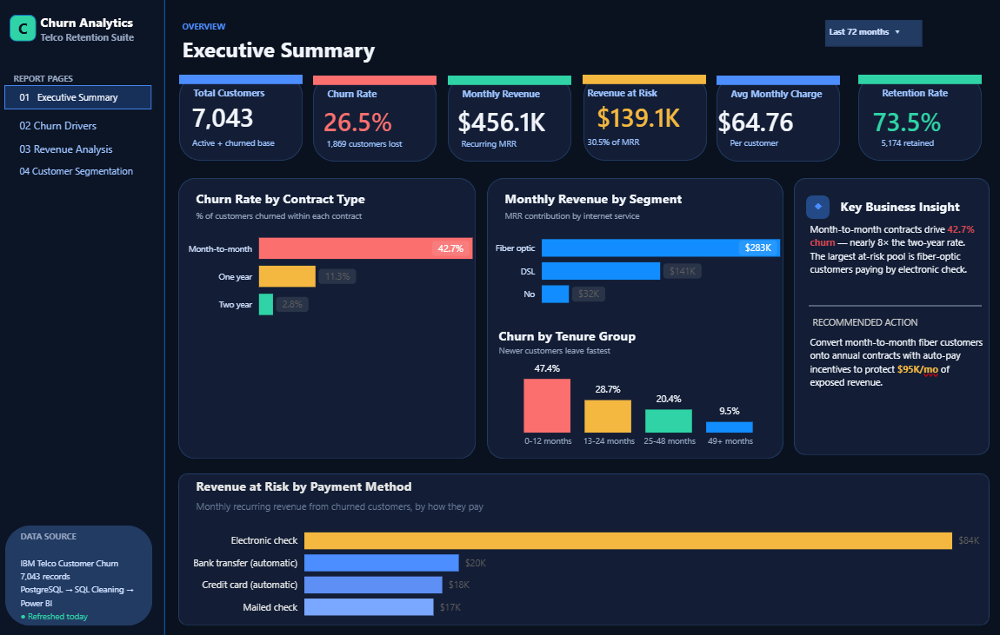

# Customer Churn & Revenue Analytics (PostgreSQL + Power BI)

> End-to-end BI project: raw telecom customer data cleaned and modeled in PostgreSQL, served through SQL views to a Power BI dashboard with DAX KPIs that quantifies churn and monthly revenue at risk.

  

## Overview

Built on the public **IBM Telco Customer Churn** dataset (7,043 customers), this project follows the workflow an analytics team would use in production: land the raw data, clean it in SQL, expose business-ready views, and build an executive dashboard on top.

## Problem / Motivation

A subscription business needs to know not just *how many* customers leave, but *how much recurring revenue is exposed* and *which segments to act on first* — by contract type, tenure, and payment method.

## Approach & tech stack

1. **Load** raw CSV into PostgreSQL (`sql/01_create_database.sql`, `sql/02_create_raw_table.sql`)
2. **Clean** with a SQL view — types, blanks, derived fields (`sql/03_cleaning_view.sql`)
3. **Model** analytical views for KPIs, churn and revenue (`sql/04`–`06`)
4. **Visualize** in Power BI (`dashboard/Customer_Churn_SQL_PowerBI_Dashboard.pbix`) with DAX measures documented in `dax/measures.md`

**Stack:** PostgreSQL · SQL (CTEs, aggregations, views) · Power BI · DAX

SQL views: `vw_telco_clean`, `vw_executive_kpis`, `vw_churn_by_contract`, `vw_churn_by_tenure_group`, `vw_revenue_by_internet_service`, `vw_revenue_at_risk_by_payment_method`, `vw_customer_segments`

## Key features

- KPI cards: customers, churn rate, monthly revenue, revenue at risk, avg. monthly charge, retention
- Churn rate by contract type and tenure group
- Monthly revenue by segment; revenue at risk by payment method
- Business-insight panel on the executive page

## Results (Executive Summary page)

| Metric | Value |
|---|---:|
| Total customers | 7,043 |
| Churn rate | 26.5% |
| Monthly revenue | $456.1K |
| Monthly revenue at risk (churned customers) | $139.1K |
| Average monthly charge | $64.76 |
| Retention rate | 73.5% |

## Status

Executive Summary page complete. Churn Drivers, Revenue Analysis and Customer Segmentation pages are in development.

## How to run

1. Create the database and tables: run `sql/01`–`02` in PostgreSQL, then load the Telco CSV (see `data/README.md`).
2. Run `sql/03`–`06` to create the cleaning and analytical views.
3. Open `dashboard/Customer_Churn_SQL_PowerBI_Dashboard.pbix` in Power BI Desktop and point the data source at your PostgreSQL instance.

---

## About the author

**Ibrahim Denis Fofanah** — Data Scientist · ML / GenAI (RAG, agents) · BI & analytics · MS Data Science, Pace University (2025)

[LinkedIn](https://www.linkedin.com/in/ibrahim-denis-fofanah/) · [Email](mailto:ibrahim.fofanah.ds@gmail.com) · [Live RAG portfolio project](https://moijey-copilot.vercel.app) · [GitHub](https://github.com/Denis060)
